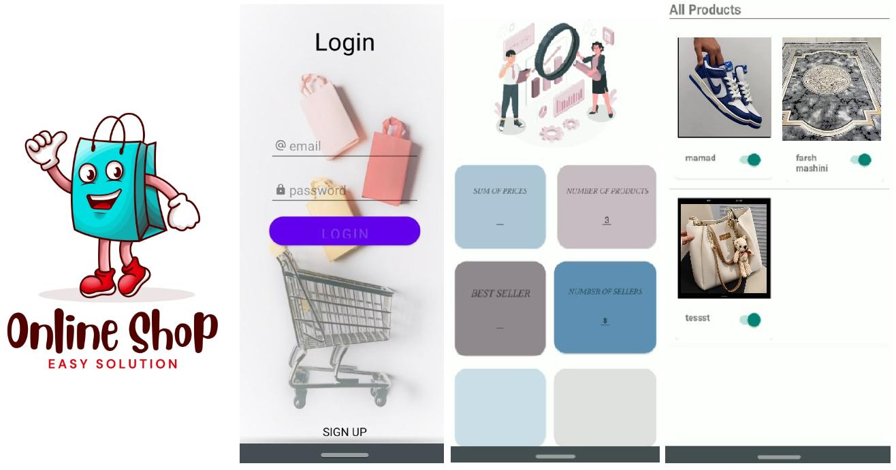

# Java Projects

A collection of Java projects — from a full-stack marketplace to focused GUI and OOP exercises. The flagship project is **Dikan**, an eBay-style online marketplace with a Spring Boot backend and a native Android client.

---

## 🛍️ Dikan · eBay-style Online Marketplace

**A full-stack marketplace where anyone can buy and sell — built with a Spring Boot REST API, a native Android client, and a polished bilingual (Persian/English) UI.**

<p align="center">
  
  
  
  
  
</p>

### About the Project

**Dikan** is a complete, eBay-style online marketplace. Sellers can list products with photos, buyers can browse, search, sort, and purchase them, and an administrator can review activity and manage the platform. The repository contains two tightly-coupled apps that work together:

| Folder | Role | Stack |
|--------|------|-------|
| [`Dikan-Server`](Dikan-Server) | Backend REST API | Java · Spring Boot · SQLite |
| [`Dikan-Android`](Dikan-Android) | Native mobile app | Java · Android SDK · Retrofit |

Built as a university project, **Dikan** demonstrates an end-to-end product: a database-backed server, a full client, authentication, an admin panel, and a polished bilingual mobile UI.

### Key Features

**For buyers**
- Register, log in, and recover a forgotten password by email
- Browse product listings with photos, pull-to-refresh, and live search
- Sort results by price (low→high / high→low)
- View product details, call the seller directly, and "buy" with one tap

**For sellers**
- Create listings with image upload (images are base64-encoded)
- Manage your shop: edit or delete your own ads at any time

**For the administrator**
- Dashboard with live analytics (products, sellers, total sales, best seller)
- Feature ("star") products to promote them
- Monitor all users and their login activity

**Under the hood**
- Token-based sessions (UUID) for authentication
- SQLite database with joined user/product relations
- RESTful API consumed by a native Android client via Retrofit
- Bilingual UI (English + Persian) with RTL support

### User Interface

<p align="center">
  
</p>

### Architecture

```
┌──────────────────────┐        HTTP / JSON         ┌──────────────────────┐
│   Dikan-Android      │  ────────────────────────▶ │    Dikan-Server      │
│  (Native client)     │  ◀────────────────────────  │   (Spring Boot API)  │
└──────────────────────┘        responses           └──────────┬───────────┘
                                                               │ JDBC
                                                         ┌─────▼─────────┐
                                                         │   SQLite DB   │
                                                         └───────────────┘
```

The Android client sends JSON requests over **Retrofit**; the Spring Boot server exposes REST endpoints that read and write to a **SQLite** database. Sessions are tracked with per-user UUID tokens.

### Getting Started

**Backend (`Dikan-Server`)**
```bash
cd Dikan-Server
./mvnw spring-boot:run
```
The API runs on `http://localhost:8080/` by default. See the [server README](Dikan-Server/README.md) for the full endpoint list.

**Android app (`Dikan-Android`)**
1. Open `Dikan-Android` in Android Studio.
2. Point the base URL in `Controler.java` to your server (default `http://192.168.1.12:8080/`).
3. Build and run on a device or emulator (min SDK 22).

### Built With

- **Java 8** — primary language across the whole stack
- **Spring Boot** — REST API scaffolding and embedded server
- **SQLite + JDBC** — lightweight relational storage
- **Android SDK** — native mobile UI (Material Components)
- **Retrofit + Gson** — networking and JSON parsing on Android
- **TextView, RecyclerView, NavigationView** — modern Android layout & navigation

---

## 🧩 Smaller Projects

**MineSweeper-GUI-Java** — A classic 8×8 Minesweeper game with a Swing GUI, built using an OOP `Button` class and array-backed board logic. 12 mines are shuffled onto the board each round, and the player reveals safe cells to win.

**Hospital-Managers-GUI-Java** — A Swing-based hospital management system with three modules: Patient records, Admin management, and Accountancy, covering doctor/nurse administration, patient profiles, and sickness submissions.

**Pixel-Class-Java** — An OOP demo modeling image pixels, where `Pixel` represents an RGB pixel with validation, a grayscale converter, and hex constructors, and `TransparentPixel` extends it with an RGBA alpha channel.

**university-manager-Command-line** — A command-line university manager driven by regex-parsed commands, supporting students, professors, courses, course assignment, enrollment listing, and salary calculation.

---

## 📄 License

This project was created for academic purposes. Feel free to use it as a learning reference.

---

<p align="center">
  ⭐ If you like this project, give it a star! ⭐
</p>
